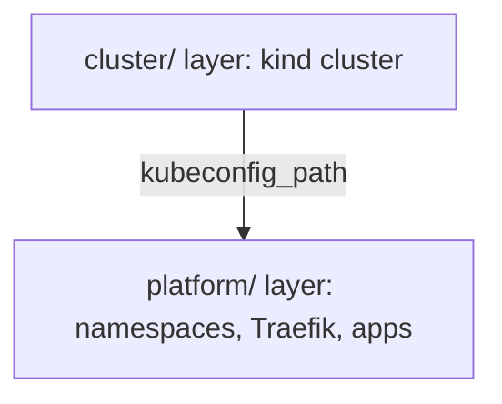

# Terraform Kubernetes Platform


I’m a systems administrator with experience in both on-prem and cloud infrastructure, and
this repo is my hands-on lab for building infrastructure as code skills with Terraform and
learning Kubernetes by building and running a local container platform. Everything here
runs on my own machine, and each project can be rebuilt from scratch with one script.

## Start here

| Project | What it is |
|---|---|
| [`k8s-platform`](k8s-platform/) | A local Kubernetes platform built only with Terraform: a kind cluster, namespaces, Traefik through Helm, and a reusable app module deployed to dev and prod. One script builds it and one removes it. |
| [`aws-lab`](aws-lab/) | Remote state with locking, plus an AWS-style VPC module with tests. Runs against a free AWS emulator, so it's practice with the AWS provider but not against a real account. |

Diagrams and design decisions are in [`docs/architecture.md`](docs/architecture.md).

## What this demonstrates

- **Terraform:** modules, `for_each`, validation and preconditions, import and
  moved blocks, remote state, locking, workspaces, `terraform test` with mocked providers.
- **Kubernetes:** Deployments, Services, Ingress, probes and limits, rollouts,
  storage, StatefulSets, RBAC.
- **Delivery:** GitHub Actions checks on every pull request (format, validate,
  tflint, unit tests, checkov), reviewed through pull requests.

## Architecture at a glance



## Run it yourself

You need Docker, Terraform, kubectl, and (for the checks) tflint and checkov. All
commands run in WSL or Linux.

```bash
# Kubernetes platform (about [N] minutes to build)
./k8s-platform/scripts/up.sh
export KUBECONFIG=$HOME/.kube/kind-platform.config
curl http://web-prod.localtest.me:8080
./k8s-platform/scripts/down.sh

# AWS lab (about [N] minute to build)
./aws-lab/scripts/up.sh
source aws-lab/scripts/env.sh
./aws-lab/scripts/down.sh
```

Run the same checks as CI locally: `./k8s-platform/scripts/check.sh` and
`./aws-lab/scripts/check.sh`.

## Earlier labs

| Folder | What it covers |
|---|---|
| `lab-01-docker`, `lab-01-rebuild` | First Terraform config with the Docker provider, variables, outputs, and a from-memory rebuild |
| `lab-02-loops-count`, `lab-02-loops-foreach` | `count` against `for_each`, and what happens when a list item is removed |
| `lab-03-modules` | A reusable module called twice with different inputs |
| `lab-04-import-refactor` | `import` and `moved` blocks |
| `lab-05-k8s-basics` | A kind cluster, pods, Deployments, scaling, self-healing |
| `lab-06-k8s-networking` | ConfigMaps, Secrets, Services, DNS, Ingress with Traefik |
| `lab-07-k8s-reliability` | Probes, limits, OOMKilled, rollouts and rollbacks |
| `lab-08-k8s-storage-rbac` | PVCs, StatefulSets, Jobs, RBAC |

## Choices and limits

- Everything is local and free. There's no live cloud account and no managed Kubernetes.
- The AWS code runs against an emulator (Moto), not real AWS.
- CI runs checks only. It doesn't plan or apply.
- `aws-lab` security findings are a baseline I haven't fixed (for example access
  logging and KMS keys). In a real account I would.
- Four `k8s-platform` security checks are skipped on purpose; the reasons are in
  comments beside them in the code.
