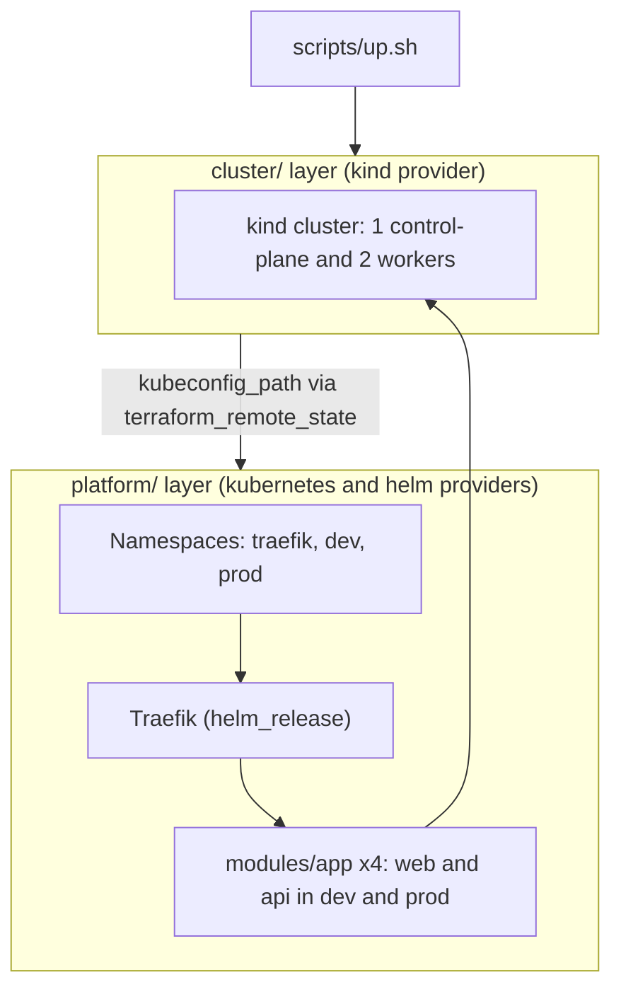
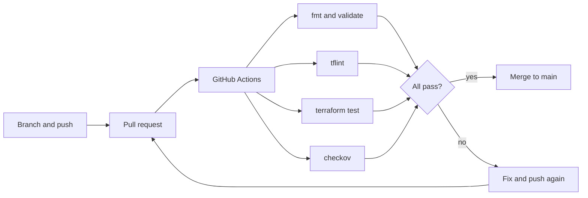
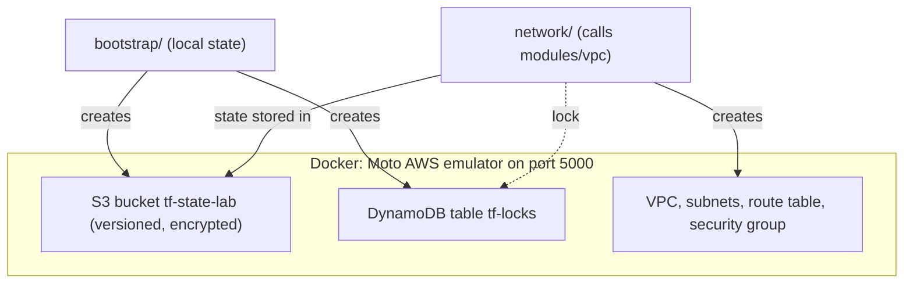

# Architecture

Two projects, one repo. Both run entirely on a laptop, so they cost nothing.

## k8s-platform: a Kubernetes platform built only with Terraform

Why two layers: the Kubernetes and Helm providers need a cluster that already
exists, so cluster creation and in-cluster configuration are separate Terraform
roots with separate state. The platform layer reads the cluster layer's output
instead of hard-coding the kubeconfig path.

## CI: every change is checked before it reaches main

## aws-lab: remote state, locking and an AWS-style module (emulated)

## Design decisions

- **Separate layers, separate state.** A cluster and the things running on it
  change at different speeds and need different providers.
- **`for_each` instead of `count`.** Items are tracked by key, so adding or removing
  one never shifts the others.
- **Environments are data, not code.** One app module serves dev and prod. Only
  the inputs differ (replicas, memory limit).
- **Guardrails in the module.** Input validation plus a precondition that stops prod
  from using a `:latest` image.
- **Pinned versions and committed lock files.** A rebuild next month installs the
  same thing.
- **Checks on every pull request.** Format, validate, lint, unit tests, security scan.
- **Moto instead of LocalStack or MinIO.** LocalStack now needs an account and MinIO
  is archived, so I used a free emulator with no sign-up.

## Known limits

- Everything is local. There is no live cloud account and no managed Kubernetes.
- The AWS code is tested against an emulator, not real AWS.
- CI reads and tests the code. It does not run `plan` or `apply`.
- The `aws-lab` security scan is a baseline. It lists findings that I would fix in
  a real account (access logging, KMS keys, flow logs, and so on) but did not fix here.
- Four `k8s-platform` checkov findings are skipped on purpose, with written reasons
  next to each one in the code.
